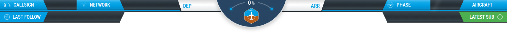

# Stream Inflight Overlay



Overlay de vol en temps réel pour OBS (source navigateur 1920 × 160 px), construit avec Vue 3 et Vite.

## Stack

- [Bun](https://bun.sh) — gestionnaire de paquets et runner
- [Vite](https://vitejs.dev) — bundler
- [Vue 3](https://vuejs.org) — Composition API, `<script setup>`
- Sass / SCSS

## Installation

```bash
bun install
```

## Développement

```bash
bun run dev
```

## Build

```bash
bun run build
```

## Configuration

Copier `.env.example` en `.env` et renseigner le nom d'utilisateur SimBrief :

```env
VITE_SIMBRIEF_USERNAME=votre_pseudo
```

Le nom d'utilisateur peut aussi être passé en paramètre URL : `?simbrief=votre_pseudo`.

## Intégrations automatiques

| Source | Intervalle | Données récupérées |
|---|---|---|
| **SimBrief** | 30 s | Callsign, aéronef, aéroports DEP/ARR, coordonnées |
| **VATSIM** | 30 s | Réseau, phase de vol, progression |
| **IVAO** | 30 s | Réseau, phase de vol, progression (fallback VATSIM) |

## API publique

Fonctions exposées sur `window` pour une intégration externe (StreamFlight, etc.) :

```js
window.setCallsign("AFR006")
window.setAircraft("A320neo")
window.setNetwork("VATSIM")
window.setFlightPhase("CRUISE")       // PREFLIGHT TAXI TAKEOFF CLIMB CRUISE DESCENT APPROACH LANDING
window.setFlightProgress(63)          // 0–100
window.setDepartureAirport("LFPG")
window.setArrivalAirport("KJFK")
window.setAirports({ departure: "LFPG", arrival: "KJFK" })
window.refreshAirportFlags()
window.setLatestFollower("AeroMax92")
window.setLatestSub("CaptainLeo")
```

## Structure

```
src/
├── main.js                        Entrée Vue + exposition de l'API window
├── App.vue                        Layout principal de l'overlay
├── components/
│   ├── InfoGroup.vue              Pills CALLSIGN / NETWORK / PHASE / AIRCRAFT
│   ├── AirportModule.vue          Modules DEP / ARR avec drapeau
│   ├── SocialStrip.vue            Bandes LAST FOLLOW / LATEST SUB
│   └── CenterModule.vue           Module central (progression SVG + logo)
├── composables/
│   ├── useOverlay.js              État réactif singleton + setters
│   ├── useSimbrief.js             Polling SimBrief
│   ├── useNetworkDetection.js     Polling VATSIM / IVAO
│   ├── useBuildTime.js            Auto-reload au redéploiement
│   └── useScale.js                Mise à l'échelle responsive
└── utils/
    └── airports.js                Table ICAO → pays + helpers
scss/
    _variables.scss
    _base.scss
    _header.scss
    _social.scss
    _airports.scss
    _center.scss
    _animations.scss
    style.scss
```
